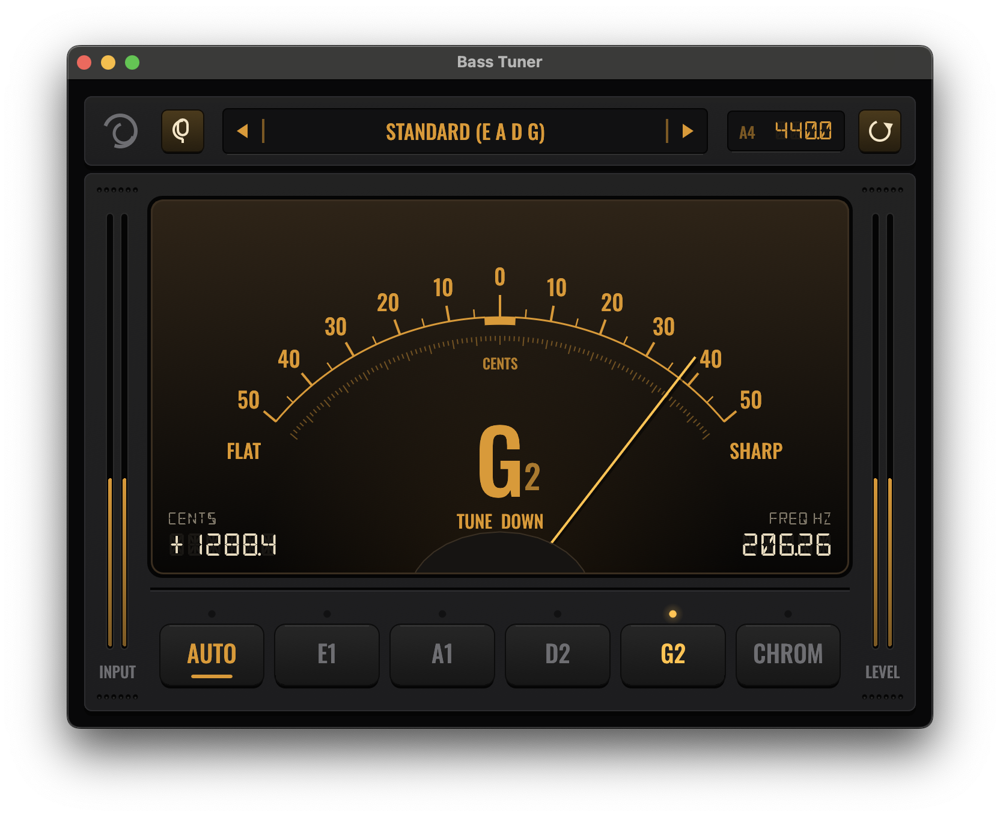

# Bass Tuner

A desktop bass guitar tuner written in Rust, styled after a vintage gold-on-charcoal VU meter.



## Features

- Pitch detection tuned for bass (27–420 Hz) using the McLeod Pitch Method, so low B on 5- and 6-string basses reads reliably
- Analog-style cents meter (±50 cents) with note name, exact cents offset and frequency readouts
- Three modes:
  - **Auto**: snaps to the closest string in the selected tuning
  - **String**: tunes toward one chosen string
  - **Chrom**: shows the nearest chromatic note
- Built-in tunings: Standard, Drop D, D Standard, Half step down, 5-string (low B or high C) and 6-string
- Adjustable A4 reference: drag or scroll to change it, double-click to reset to 440 Hz
- Input device selection and input level meters

## Download

Prebuilt packages are attached to each GitHub release:

| Platform | File |
| --- | --- |
| Debian / Ubuntu | `.deb` |
| Fedora / openSUSE | `.rpm` |
| Other Linux | `.tar.gz` |
| Windows | `.msi` installer or standalone `.exe` |
| macOS (Apple silicon) | `.zip` containing `Bass Tuner.app` |

The macOS app isn't notarized. The first time you open it, right-click it and choose **Open**.

## Releasing

Bump `version` in `Cargo.toml`, then push a matching tag:

```sh
git tag v0.1.0
git push origin v0.1.0
```

The [release workflow](.github/workflows/release.yml) builds every package and publishes them to a GitHub release.

## Build and run

Requires a recent stable Rust toolchain (edition 2024).

```sh
cargo run --release
```

### macOS app bundle

```sh
./scripts/make-app.sh
```

This builds `target/release/Bass Tuner.app` with its icon and microphone permission. macOS asks for microphone access the first time it runs.

## Project layout

| Path | Purpose |
| --- | --- |
| `src/main.rs` | Window setup |
| `src/ui.rs` | Tuner UI (egui) |
| `src/audio.rs` | Audio capture (cpal) and the analysis thread |
| `src/pitch.rs` | Filtering, decimation and pitch detection |
| `src/notes.rs` | Note names, cents and tunings |
| `src/icon.rs` | Procedurally drawn app icon |
| `examples/render_icon.rs` | Renders the icon to a file for the app bundle |

## Tests

```sh
cargo test
```

## License

Copyright 2026 Eric Afenyo. Licensed under the [Apache License, Version 2.0](LICENSE).

## Fonts

The app bundles [Oswald](https://fonts.google.com/specimen/Oswald) and [DSEG14](https://github.com/keshikan/DSEG). Both are licensed under the SIL Open Font License; see `assets/fonts/`.
